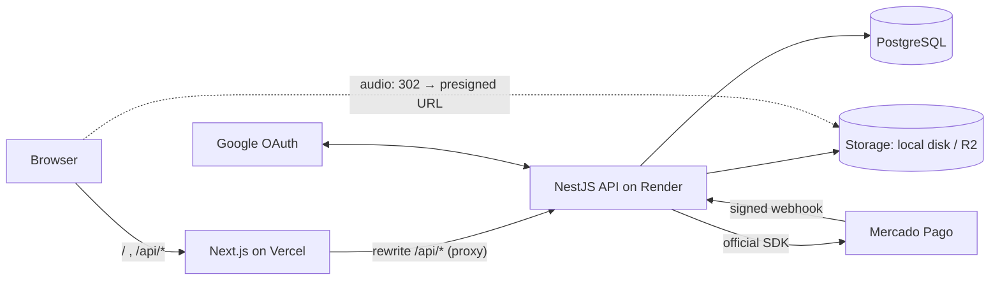

# Waven — Architecture

## 1. Overview



- The web acts as an **API proxy** (`/api/*` → API). The browser sees a single domain and the refresh cookie is first-party, with no `SameSite=None` and no credentialed CORS.
- **Audio** does not go through Vercel. In dev, the API serves Range requests straight from disk. In prod, `/stream` validates the token and redirects to a presigned R2 URL, which handles the Range.

## 2. Monorepo structure

```
waven-music-platform/
├─ apps/
│  ├─ api/                     NestJS
│  │  ├─ src/
│  │  │  ├─ config/            validated env schema
│  │  │  ├─ common/            guards, decorators, filters, interceptors
│  │  │  ├─ database/          data-source.ts, migrations/
│  │  │  └─ modules/           auth, users, catalog, storage, media, streaming,
│  │  │                        search, playlists, library, billing, admin, health
│  │  ├─ scripts/              seed-jamendo.ts, import-local.ts, export-openapi.ts
│  │  ├─ test/                 e2e (supertest) + helpers
│  │  └─ openapi.json          generated and committed (contract with the web)
│  └─ web/                     Next.js App Router
│     ├─ src/
│     │  ├─ app/               (auth)/login, (app)/…, (admin)/admin/…
│     │  ├─ components/ui/     shadcn/ui
│     │  ├─ components/        layout/, player/, cards/, …
│     │  ├─ features/          per-domain logic (Query hooks, components)
│     │  ├─ lib/api/           schema.ts (generated), client.ts, query keys
│     │  ├─ stores/            player.store.ts, auth.store.ts (Zustand)
│     │  └─ styles/            tokens.css, globals.css
│     └─ e2e/                  Playwright
├─ docs/  ·  docker-compose.yml  ·  .github/workflows/ci.yml
├─ pnpm-workspace.yaml  ·  tsconfig.base.json  ·  eslint.config.mjs  ·  .prettierrc
└─ storage/                    local files (gitignored)
```

**No `packages/`:** there is a single consumer of shared types (the web), and those types come from the generated OpenAPI. Shared configuration (tsconfig and ESLint) lives at the root. If a second consumer shows up, it gets extracted into a package.

## 3. Technical decisions

| Decision | Rationale |
|---|---|
| pnpm workspaces, Node 24 LTS | Fast, strict about dependencies and without the complexity of Turborepo or Nx. |
| TypeORM + migrations (`synchronize: false`) | Required by the stack; migrations make schema changes reviewable and reproducible. |
| Config validated with `class-validator` at startup | Fails fast when a variable is missing, without adding Joi or Zod. |
| `nestjs-pino` for logging | Structured JSON, a `requestId` per request and redaction of sensitive headers. |
| `@nestjs/throttler` | Global rate limiting (100/min) and a strict one on auth (10/min); trusts Render's proxy. |
| Helmet + allowlisted CORS | CORS is only needed for Swagger and dev; normal traffic goes through the proxy. |
| Passport Google → 15 min access JWT in memory + 30-day refresh | The access token never touches storage, so it is not exposed to persistent XSS. The refresh token rotates, and reusing one revokes the whole family. |
| Refresh cookie `httpOnly; Secure; SameSite=Lax; Path=/api/auth` | Minimal exposure. As CSRF protection, refresh requires an `X-Requested-With` header and a valid `Origin`. |
| Signed stream token in the query string (HMAC, 1 h) | `<audio>` cannot send an `Authorization` header, and the token is bound to the user, the track and the quality. |
| `StorageDriver` (`local` \| `s3`) | Same interface (`put`, `getStream(range)`, `getSignedUrl`, `delete`). R2 in prod via `@aws-sdk/client-s3`. |
| ffmpeg (`ffmpeg-static`) | Transcodes to 128 and 320 kbps MP3. The binary is bundled so it does not depend on the system (Windows and Render). |
| In-process job queue, with state in the database | Transcoding is occasional and does not justify Redis or BullMQ. `Track.status` reflects progress. |
| `sharp` | Resizes covers (WebP at 64, 300 and 640 px) and extracts the dominant color once, on the server. |
| `music-metadata` | Reads ID3 tags in `catalog:import`. |
| Search with `pg_trgm` + `unaccent` (GIN indexes) | Fuzzy, accent-insensitive search without adding Elasticsearch. Enough for thousands of rows. |
| `PaymentProvider` (`MercadoPagoPreapproval` \| `MercadoPagoCheckoutPro`) | Switched with `PAYMENT_MODE`. The domain (Subscription and its states) does not know about Mercado Pago. |
| Typed client: `openapi.json` → `openapi-typescript` → `openapi-fetch` | Generated types without heavy runtime code. A middleware injects the token and retries after a refresh on a 401. |
| TanStack Query + query key factories | Caching, invalidation and optimistic updates (favorites, reordering). |
| Zustand for the player | Global, synchronous state (queue, index, modes), persisted in `localStorage` except the position. |
| Tailwind + shadcn/ui + tokens as CSS variables | Accessible components (Radix) under our own control. The tokens allow a future light theme. |
| `@dnd-kit` | Drag-and-drop track reordering, keyboard accessible. |
| `motion` (only for the expanded player and transitions) | Subtle animations that respect `prefers-reduced-motion`. Everything else is done with CSS. |
| Authenticated pages rendered on the client, with skeletons | The access token lives in memory. The Next middleware only redirects based on a `waven_session` indicator cookie, with no secret. |

## 4. Key flows

**Login**
1. `/api/auth/google` → Google → `/api/auth/google/callback`. The API upserts the user, sets the cookie and redirects to `/`.
2. The web calls `POST /api/auth/refresh` and keeps the `accessToken` in memory.

**Playback**
1. The store requests `POST /tracks/:id/stream` and receives the signed URL.
2. `<audio src>` plays it with Range requests. At 30 s, `POST /me/history` is sent.
3. The URL of the next track is preloaded.

**Payment**
1. `POST /billing/checkout` creates the Subscription as `pending` and returns the Mercado Pago `init_point`, to which the browser is redirected.
2. Mercado Pago notifies via webhook. The API validates the signature, deduplicates, fetches the resource again and transitions the state.
3. The web returns to `/billing/return` and polls `GET /billing/subscription` until it sees a final state.

## 5. Security

- No secrets in the repo: `.env.example` per app, `.env*` in `.gitignore` and, in CI, GitHub secret scanning and `pnpm audit` (non-blocking).
- Global `ValidationPipe` with `whitelist` and `forbidNonWhitelisted`, DTOs on every input and `ParseUUIDPipe` on every id.
- Guards: global `JwtAuthGuard` (opt out with `@Public()`), `RolesGuard` with `@Roles('admin')`, and resource ownership checked in the service with a `WHERE ownerId = :userId` query.
- Webhook: HMAC-SHA256 over the manifest `id:{data.id};request-id:{x-request-id};ts:{ts};` with constant-time comparison, plus a tolerance window for `ts`.
- Uploads: the type is validated with magic bytes (not just the extension), there are size limits and storage names are UUIDs.
- Logs: `authorization`, `cookie` and `token` are redacted. 5xx errors do not expose the stack trace.
- The test login route is registered only when `NODE_ENV=test` **and** `E2E_AUTH_BYPASS=true`. A test verifies it does not exist in production.

## 6. Testing

| Level | Tool | What it covers |
|---|---|---|
| Unit | Jest | Services with logic: effective plan, limits, token rotation, subscription state machine, webhook signature, reordering. |
| API e2e | Jest + supertest + real Postgres (`db-test` in Compose; service container in CI) | Auth and refresh, per-resource authorization, playlist CRUD, Range (206 and 416), checkout + idempotent webhook with a fake `PaymentProvider`, admin endpoints. |
| Web e2e | Playwright | Login (test bypass) → play an album → create a playlist → add a track → search → upgrade flow with the fake provider. |

- Each e2e suite runs migrations on a clean database, with a minimal fixture of 3 synthetic audio tracks generated with ffmpeg.
- Priority: critical flows and edge cases over coverage percentage.

## 7. Design tokens

| Token | Value | Usage |
|---|---|---|
| `--bg` | `#0B0B10` | App background |
| `--surface` / `--surface-2` / `--elevated` | `#14141C` / `#1C1C27` / `#252533` | Sidebar, cards, menus |
| `--border` | `#2E2E3D` | Borders and dividers |
| `--text` / `--text-muted` | `#F4F4F8` / `#A1A1B5` | Contrast ≥ 7:1 on `--surface` |
| `--accent` / `--accent-hover` | `#8B7BFF` / `#A196FF` | "Wave violet" brand color, ~6:1 contrast on `--bg`. Text on top of it uses `--bg`. |
| `--accent-2` | `#3DD9D6` | Brand gradients and visualizer |
| `--danger` / `--warning` / `--success` | `#FF6B6B` / `#FFC857` / `#4ADE80` | Status only |
| `--focus-ring` | `2px solid var(--accent)` with a 2px offset | Focus always visible |

- **Typography:** Geist Sans (UI) and Geist Mono (durations and times), via `next/font`. Scale: 12 / 14 / 16 / 20 / 24 / 32 / 48 px.
- **Spacing:** 4 px base (`1 = 4px`). 16 px gutter on mobile and 24 px on desktop.
- **Radii:** `sm 6px`, `md 10px`, `lg 16px`, `full`. Covers use `md` and artists use `full`.
- **Motion:** 150 ms (hover) and 250 ms (panels) with `cubic-bezier(.2,.8,.2,1)`. Disabled under `prefers-reduced-motion`.
- **Dominant color:** `Album.dominantColor`, darkened until it reaches AA contrast with `--text`, used as the header gradient (`color → --bg`).
- **Layout:**
  - Desktop (≥ 1024 px): 280 px sidebar + content + 88 px player bar.
  - Tablet: sidebar collapsed to icons.
  - Mobile (≥ 360 px): mini player above a 4-item bottom navigation, and a full-screen player as a sheet.
